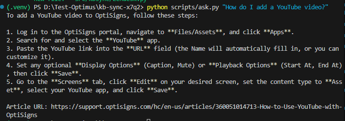

My scraper-uploader → Gemini File Search

Scrapes all published articles from the Zendesk Help Center API (`en-us`), converts them to clean Markdown, uploads them to a Gemini File Search vector store, and re-syncs daily (delta only). Powers **OptiBot**, a factual customer-support assistant that cites source articles.

## Setup

```bash
cp .env.sample .env          # add your GEMINI_API_KEY
pip install -r requirements.txt
```

## Run locally

- create .env file and add your GEMINI_API_KEY into enviroment variables
- Bạn mở PowerShell và chạy 1 lệnh duy nhất (chỉ cần chạy một lần)
- [System.Environment]::SetEnvironmentVariable('GEMINI_API_KEY', 'your GEMINI_API_KEY', 'User')

```bash
# Task 1 — Scrape → data/articles/*.md
python scripts/scrape.py --out data/articles --save-raw

# Validate quality (0 errors expected)
python scripts/validate_md.py data/articles

# Task 2 — Full-load upload to Gemini File Search store
python scripts/upload.py --dir data/articles

# Test the assistant (requires store to be populated)
python scripts/ask.py "How do I add a YouTube video?"

# Task 3 — Scrape + delta + upload in one shot (what Docker runs)
python main.py
```

## Docker

```bash
docker build -t kb-sync .
docker run --rm -e API_KEY=<your_key> kb-sync
```

## Chunking strategy

- White-space chunks of **400 tokens, 60 token overlap** (`white_space_config`). One document per article so citations map 1:1 to a Zendesk article. Chunk size keeps complete how-to steps together (most articles are 300–1 500 tokens); overlap prevents context loss at boundaries. Configurable via `CHUNK_MAX_TOKENS` / `CHUNK_OVERLAP_TOKENS`.

- Chunking: white_space_config, 400 token/chunk, overlap 60 (~15%).

- Lý do: bài help ngắn (thường vài trăm đến ~1.5k token), nội dung là chuỗi bước. Chunk quá nhỏ (< 200) cắt rời các bước; quá lớn (> 800) làm loãng điểm tương đồng. Overlap giữ ngữ cảnh ở ranh giới.
- Mỗi bài = 1 file = 1 document trong store (giữ ranh giới bài để citation chính xác).
- Có thể tinh chỉnh bằng env CHUNK_MAX_TOKENS / CHUNK_OVERLAP_TOKENS mà không sửa code.

## Delta strategy

Content hash: `sha256(title.strip() + "\n" + markdown_body)` — deliberately excludes `updated_at` so metadata-only edits don't trigger re-uploads. State is read back from the Gemini store's `custom_metadata` (Plan A) or from the `<slug>__<hash8>.md` display_name encoding (Plan B fallback). No persistent disk needed — compatible with Render Cron.

## Daily job

Render Cron Job (Docker), schedule `0 20 * * *` UTC (= 03:00 ICT). Set `GEMINI_API_KEY` in the Render dashboard. Each run exits 0 on success, 1 if any upload failed.

Log format (stdout, grepped from Render **Runs** tab):
```json
{"event":"run_summary","fetched":412,"added":0,"updated":1,"skipped":411,"deleted":0,"failed":0,"chunks_estimated":1876,"duration_s":94.2}
```

## Assistant sanity check
- vì AI Studio UI](https://aistudio.google.com/) không có tool File Search - để trỏ tới store vì vậy assistant được dựng bằng scripts/ask.py
- scripts/ask.py (assistant chính thức): đọc system_prompt.txt + store, gọi model với tool File Search, in câu trả lời và danh sách citation. Chụp màn hình terminal

- 

After upload, open [AI Studio](https://aistudio.google.com/), create a new prompt, paste the system instructions from `prompts/system_prompt.txt`, attach the `optibot-support-kb` store under **Tools → File Search**, and ask:

> **"How do I add a YouTube video?"**

Expected: ≤ 5 bullet points, up to 3 `Article URL:` citations pointing to the correct article.

Alternatively run `python scripts/ask.py "How do I add a YouTube video?"`.

## Tests

```bash
pytest -q                       # all unit tests
python scripts/validate_md.py data/articles   # data quality check
```

## What I cut / next steps

- Section/category enrichment (`get_sections()`) is implemented but off by default to save API calls during the first run; enable by running with any network connectivity.
- `scripts/spike_gemini.py` (S2 spike) skipped — API shape confirmed from `google-genai 2.33.0` installed.
- GitHub artifact push (spec §9.5) not implemented; Render log screenshot suffices for the demo.

